 

<h2>👩‍💻 About Me</h2>

  I'm an <b>MCA student (2025–2027)</b> specializing in
  <b><ins>Cyber Security &amp; Digital Forensics</ins></b>.

  I like understanding how systems work,  
  and then <i>how they break</i>.

<ul>
  <li>☕ Writing <b>Java</b>, one semicolon at a time</li>
  <li>🔐 Learning <b>cyber security</b> and <b>digital forensics</b></li>
  <li>📊 Exploring <b>data analytics</b> and <b>AI</b></li>
  <li>🧩 Practicing <b>DSA</b>, because the interview gods demand it</li>
  <li>🚀 Preparing for <b>product and service based placements</b></li>
  <li>🐈 Part-time code reviewer, full-time cat person</li>
</ul>
<h2>🛠 Tech Stack</h2>

  

<h2>🚀 Featured Projects</h2>
<table>
  <thead>
    <tr>
      <th align="left">Project</th>
      <th align="left">What it does</th>
    </tr>
  </thead>
  <tbody>
    <tr>
      <td><a href="https://github.com/asr-stack/ToneShift-"><b>ToneShift</b></a></td>
      <td>Translates Gen-Z slang into professional corporate tone</td>
    </tr>
    <tr>
      <td><b>LocalLift</b></td>
      <td>Local business recommendation system</td>
    </tr>
    <tr>
      <td><a href="https://github.com/asr-stack/EcoPark-Hub"><b>EcoPark-Hub</b></a></td>
      <td>Eco-friendly park web project</td>
    </tr>
    <tr>
      <td><a href="https://github.com/asr-stack/Cyber-Security-Projects"><b>Cyber-Security-Projects</b></a></td>
      <td>Python experiments in security and forensics</td>
    </tr>
    <tr>
      <td><a href="https://github.com/asr-stack/Data-Science-Projects-"><b>Data-Science-Projects</b></a></td>
      <td>Jupyter notebooks on data science</td>
    </tr>
  </tbody>
</table>
<h2>😅 Developer Life</h2>

  

  Thanks for stopping by. Feel free to say hi, or tell me my code has a bug (it probably does).

